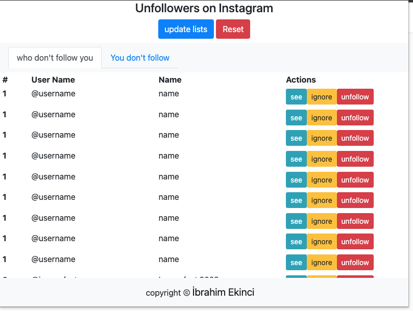
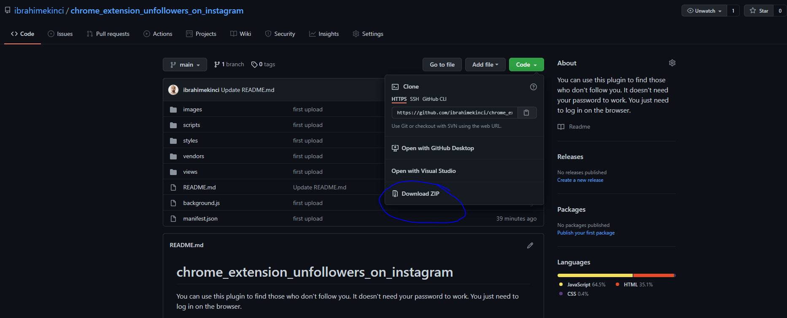
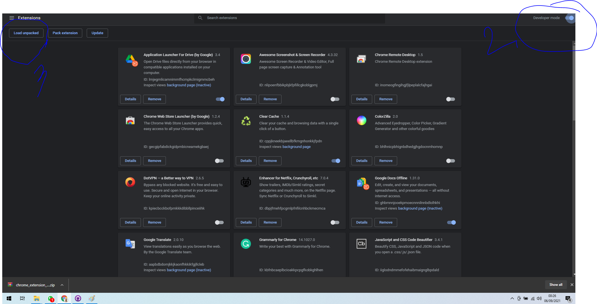
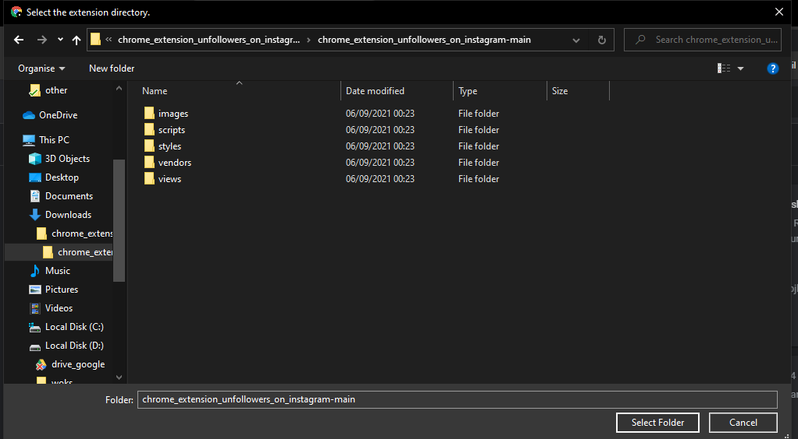
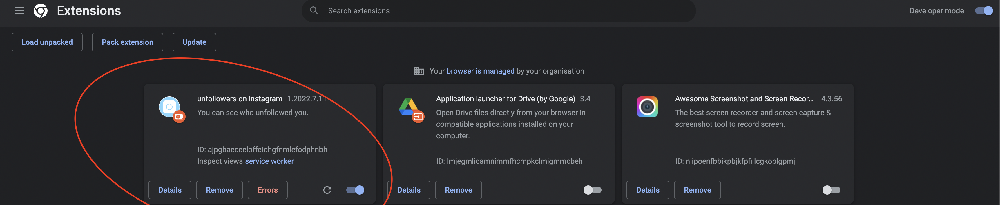

# 📦 Unfollowers on Instagram – Chrome Extension

A privacy-friendly Chrome extension to see who doesn't follow you back on Instagram.  
✅ No password required  
✅ No API access  
✅ Works directly inside your browser session

---

## 📸 Demo Screenshots

Demo images from the extension interface:

<p align="center">
  
</p>

---

## 🔧 How to Install (Manual Setup)

Due to Chrome Store restrictions on "Instagram"-named extensions, this extension is **only available via manual installation**.

### 📥 Step 1 – Download the Extension

- Go to the GitHub page:  
  🔗 https://github.com/ibrahimekinci/chrome_extension_unfollowers_on_instagram/

- OR download the latest version as a ZIP file directly:  
  📦 [Download ZIP](chrome_extension_unfollowers_on_instagram.zip)

---

### 🛠️ Step 2 – Load via Developer Mode

Open Google Chrome and follow these steps:

1. Go to `chrome://extensions/`
2. Enable **Developer mode** (top right corner)  
   

3. Click **Load unpacked**  
   

4. Select the unzipped folder  
   

5. You will see the extension added  
   

---

## 🚀 How It Works

- Make sure you're logged into [Instagram](https://www.instagram.com) on an active tab.
- Click the extension icon
- Click **Update Lists** to compare:
  - Who doesn’t follow you back
  - Who you don’t follow back

### 📑 Tabs and Actions

There are **two tabs** in the UI:

#### 🔹 Tab 1: "Who don't follow you"
Lists the users you follow, but who don't follow you back.

| Button     | Function                                                                 |
|------------|--------------------------------------------------------------------------|
| 🔵 **see**     | Opens the user’s Instagram profile in the browser tab.               |
| 🟡 **ignore**   | Hides the user from the list temporarily.                             |
| 🔴 **unfollow** | Unfollows the selected user via browser action.                       |

#### 🔹 Tab 2: "You don't follow"
Lists the users who follow you, but you don't follow back.

| Button     | Function                                                                 |
|------------|--------------------------------------------------------------------------|
| 🔵 **see**     | Opens the user’s Instagram profile in the browser tab.               |
| 🟡 **ignore**   | Hides the user from the list temporarily.                             |
| 🟢 **follow**   | Opens the user's profile so you can follow them manually.              |

- Use the **Reset** button to clear lists and start over.

---

## 📁 Project Structure

```
📦 chrome_extension_unfollowers_on_instagram/
├── images/             # Extension icons
├── scripts/            # Core logic
├── styles/             # CSS
├── vendors/            # External libs
├── views/              # HTML templates
├── docs/
│   ├── how to install/         # 1.PNG–5.PNG install steps
│   └── Web store/images/       # Demo screenshots
├── background.js
├── manifest.json
└── README.md
```

---

## 🛡️ Privacy

- No data is collected or sent to a server.
- All logic runs in your browser session.
- You don’t enter your Instagram password.

---

## 📜 License

MIT License  
© 2025 İbrahim Ekinci

---

## 🔗 GitHub

[https://github.com/ibrahimekinci/chrome_extension_unfollowers_on_instagram](https://github.com/ibrahimekinci/chrome_extension_unfollowers_on_instagram)
